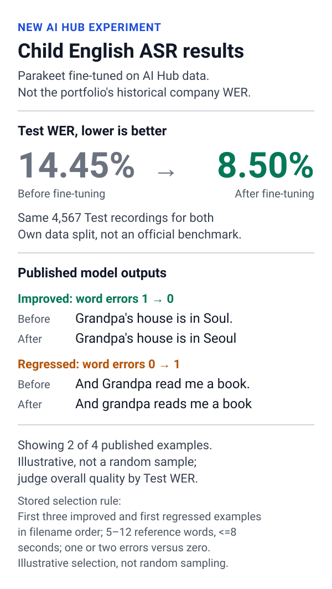

# English Assessment Systems

[English](README.en.md) · [프로젝트](#projects) · [Quick Start](#quick-start) · [공통 디렉터리 기준](docs/repository_structure.md)

## About

**발표 영상 분석, 영어 글쓰기 데이터 생성, 아동 영어 음성 인식을 한곳에 모았습니다.**

크레버스에서 수행했던 업무를 바탕으로 각 기능을 다시 구현한 포트폴리오 모노레포입니다.
세 프로젝트는 독립적으로 살펴볼 수 있습니다. 발표 태도 평가와 글쓰기 모듈은
Python 3.13·`uv.lock`을 공유하고, 아동 ASR 학습은 별도 CUDA 환경에서 실행합니다.
회사 코드·내부 데이터·학습 가중치는 포함하지 않습니다.

## Projects

### [Presentation Attitude Assessment →](presentation_attitude_assessment/README.md)

**발표 영상 하나에서 얼굴·손 랜드마크를 추출해 영상 전체의 태도를 판정하는 구조입니다.**
FFmpeg로 프레임을 읽고 MediaPipe 좌표를 정규화·평활화해 PyTorch GRU에 전달합니다.
전처리 비교 이미지, 합성 데이터 학습·평가 예제, FastAPI 업로드 데모를 볼 수 있습니다.

`FFmpeg` · `MediaPipe` · `PyTorch` · `FastAPI`

### [Writing Data Synthesis →](writing_data_synthesis/README.md)

**요청한 학년·글 유형의 기준으로 영어 글을 만들고 검수합니다.**
유치원부터 12학년까지 39개 루브릭 조합 중 하나를 고르고,
생성·검수·결과 저장을 Python 워크플로로 연결합니다.
모델 서버 없이 Mock API와 UI를 실행할 수 있습니다.

`Python` · `OpenAI 호환 SDK` · `FastAPI` · `SQLite`

### [Child Speech Recognition →](child_speech_recognition/README.md)

**한국 아동의 영어 음성에 맞춰 Parakeet을 파인튜닝했습니다.**
AI Hub 음성의 고정 Test에서 WER가 **14.45% → 8.50%**로 줄었습니다.
공개 가능한 평가 수치와 전사 예시를 볼 수 있으며, 음성·정답 파일은 재배포하지 않습니다.

[](child_speech_recognition/README.md#results)

이 수치는 AI Hub 데이터로 새로 진행한 실험 결과로, 포트폴리오에 적힌 과거 회사 시스템의 WER와는 다릅니다.
[자세한 결과와 주의 사항](child_speech_recognition/README.md#results)

`NVIDIA NeMo` · `Parakeet TDT` · `PyTorch` · `AI Hub`

## Quick Start

[uv](https://docs.astral.sh/uv/)를 설치한 뒤 저장소 루트에서 공통 환경을 준비합니다.

```sh
uv sync --locked
```

바로 실행할 수 있는 예제:

| 프로젝트 | 시작할 곳 | 확인할 내용 |
|---|---|---|
| 발표 태도 평가 | [Quick Start](presentation_attitude_assessment/README.md#quick-start) | 합성 좌표로 학습·평가 흐름 확인 |
| 글쓰기 데이터 생성 | [Quick Start](writing_data_synthesis/README.md#quick-start) | Mock 생성·검수·SQLite 저장 확인 |
| 아동 음성 인식 | [결과와 실행 방법](child_speech_recognition/README.md#quick-start) | 공개된 Test 결과 확인 |

CUDA 학습 환경이나 실제 입력 데이터가 필요한 작업은 각 프로젝트의 안내를 따릅니다.
[공통 Python 환경](docs/python_environment.md) · [디렉터리 기준](docs/repository_structure.md)

## Repository Layout

| 경로 | 내용 |
|---|---|
| `presentation_attitude_assessment/` | 영상 전처리·학습·분석 API |
| `writing_data_synthesis/` | 학년별 루브릭·글 생성 및 검수 |
| `child_speech_recognition/` | 아동 ASR 실험·공개 결과 |
| `docs/` | 공통 환경과 폴더 구조 안내 |

[MIT License](LICENSE). 외부 데이터와 영상에는 각각 원본의 이용 조건이 적용됩니다.
