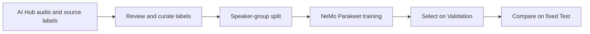

# Child Speech Recognition

[한국어](README.md) · [Results](#results) · [Experiment record](docs/EXPERIMENTS.md) · [Repository layout](../docs/repository_structure.md)

## About

**Fine-tuning Parakeet to transcribe Korean children's English speech more accurately.**

This portfolio project reconstructs work on children's English transcription at Creverse.
It is a new experiment on AI Hub data; the results below are not metrics from the historical company system.
Company code, internal data and weights are not included.

## Quick Start

You can inspect the published metrics without setting up the training environment.
Run this from the monorepo root:

```sh
python3 -m json.tool child_speech_recognition/results/test.json
```

`before.wer` of 0.14448 means 14.45%; `after.wer` of 0.08497 means 8.50%.
Audio and trained model weights are not in the repository.

## Flow



| Step | Implementation |
|---|---|
| Review labels | Check typos and unclear markers; compare some recordings with local Whisper transcripts |
| Prepare data | Split the AI Hub 541 free-speech subset by speaker group |
| Train | Parakeet TDT 0.6B v2, NVIDIA NeMo, an explicit PyTorch loop and AdamW |
| Select a model | Measure Validation WER every 0.25 epoch and keep the lowest |
| Evaluate | Compare WER and CER on identical Test audio, references and text normalization |

### Label Review

If a transcript is wrong, the model learns the wrong target. Before training,
we checked the source labels for typos and unclear markers such as `NNN`. We also
compared some recordings with local Whisper transcripts. A disagreement alone
wasn't enough to change a label. Uncertain text stayed as it was, and recordings
marked `NNN` were excluded.

We captured these rules in the [`asr-review-labels` command](src/child_speech/cli/review_labels.py).
`queue` lists labels to revisit; `apply` uses only changes approved by a reviewer.
The source ZIP stays untouched. These **fictional examples** show what happens:

| Source label | Action |
|---|---|
| `I can spel.` | Correct `spel` to `spell` if the typo is confirmed |
| `NNN sees a rose.` | Exclude because the missing words cannot be recovered |
| `I saw a tree.` | Keep the source even if Whisper writes `I see a tree.` |

The [review guide](docs/EXPERIMENTS.md#label-review) covers the command and approval
file format. It is also available [in Korean](docs/LABEL_REVIEW.md).

### Data & Model

The source is the **free-speech portion of the official Validation set** in
[AI Hub's children's English speech dataset](https://aihub.or.kr/aihubdata/data/view.do?dataSetSn=541).
The Train/Validation/Test sets below are our own repartition, not the provider's
official evaluation splits.

| Split | Utterances | Duration | Purpose |
|---|---:|---:|---|
| Train | 41,183 | 58.87 hours | Fine-tune the model |
| Validation | 5,178 | 7.16 hours | Select a checkpoint during training |
| Test | 4,567 | 7.41 hours | Compare the selected model with the baseline |

The **2.75-epoch checkpoint** had the lowest Validation WER during the three-epoch
run, at **10.78%**. We used Test only after choosing that checkpoint; selecting it
by Test score would make the final result look better than it is. The target of
less than 10% Validation WER was not reached. The [experiment record](docs/EXPERIMENTS.md)
has the full setup.

## Results

**WER fell from 14.45% to 8.50% on the same 4,567 Test recordings.**

| Metric | Before fine-tuning | After fine-tuning |
|---|---:|---:|
| Word error rate ↓ | 14.45% | **8.50%** |
| Character error rate ↓ | 8.14% | **4.54%** |

WER counts substitutions, deletions and insertions against the reference words.
The relative reduction in word errors was **41.2%**.
[Exact metrics](results/test.json) · [Validation record](results/validation.json)

### Transcript examples

| Before | After | Word errors against reference |
|---|---|---:|
| Grandpa's house is in Soul. | Grandpa's house is in Seoul | 1 → 0 |
| And Grandpa read me a book. | And grandpa reads me a book | 0 → 1 |

We picked one improvement and one regression to illustrate the outputs. They are
not a random sample; the Test WER above is the measure of overall performance.
The references are the dataset's supplied labels. [More examples and the selection rule](results/examples.json)

This is not an official AI Hub benchmark score. The same Test data had been seen
in earlier experiments, so it is not a fresh external holdout. Speaker separation
used metadata; we did not independently verify each person's identity.

## How to Run

### Prerequisites

Training requires a separate **Linux/CUDA and NeMo environment** and authorized AI Hub audio.
NeMo is not part of the shared application environment.
Follow the [environment and fixed-split setup](docs/EXPERIMENTS.md#run-the-code) first.

### Data Preparation

1. Obtain authorized access to the [AI Hub dataset](https://aihub.or.kr/aihubdata/data/view.do?dataSetSn=541).
   Place the official Validation free-speech labels `VL_eng_free_01.zip` and audio
   `VS_eng_free_01.zip` in `.local-data/aihub541/`.
2. [Review labels](docs/EXPERIMENTS.md#label-review) and apply only approved changes.
   The command writes `eligible.jsonl` and `excluded.jsonl`; it does not create
   Train/Validation/Test manifests.
3. Training needs speaker-group-separated `splits/{train,validation,test}.jsonl`.
   The recorded experiment checked metadata groups and duplicate audio hashes,
   then repartitioned at roughly 80:10:10. Its approvals and fixed manifests are
   private. The public review command does not generate these splits, so a new
   split is a separate experiment with potentially different metrics.

### Train & Test

On the CUDA host, from the repository root, after the environment and data are ready:
`ASR_DATA_DIR` must contain the source audio ZIP and recorded
`splits/{train,validation,test}.jsonl` files. Choose a new experiment output directory.

```sh
export ASR_DATA_DIR="$PWD/.local-data/aihub541"
export ASR_RUN_DIR="$PWD/.local-data/asr-nemo-reproduction"
.local-data/asr-nemo-venv/bin/python -m child_speech.cli.train
.local-data/asr-nemo-venv/bin/python -m child_speech.cli.evaluate_test
```

Run the second command only after Validation checkpoint selection.
The data, split manifests and checkpoint are not public, so the repository alone cannot
reproduce the reported training result.

<details>
<summary><strong>Build local listening examples with authorized audio</strong></summary>

Prepare the paired prediction files, then run:

```sh
uv pip install --python .venv/bin/python --no-deps -e child_speech_recognition
.venv/bin/python -m child_speech.cli.build_examples \
  --before .local-data/asr-nemo/test-0.jsonl \
  --after .local-data/asr-nemo/test-28314.jsonl \
  --audio-zip .local-data/aihub541/VS_eng_free_01.zip \
  --private-output .local-data/asr-listening \
  --public-output child_speech_recognition/results/examples.json
```

Open `.local-data/asr-listening/index.html` locally.
The HTML embeds the source audio and must remain private.

</details>

## Explore the Code

Python code lives in [`src/child_speech`](src/child_speech).

| Area | Start here |
|---|---|
| Audio and model loading | [`common/`](src/child_speech/common) |
| Label candidates and approvals | [`data/`](src/child_speech/data) |
| Fine-tuning | [`training/`](src/child_speech/training) |
| Fixed Test evaluation | [`evaluation/`](src/child_speech/evaluation) |
| Before/after reporting and local listening | [`reporting/`](src/child_speech/reporting) |
| Commands | [`cli/`](src/child_speech/cli) |

Public aggregate metrics are in [`results/`](results); experiment details are in
[`docs/EXPERIMENTS.md`](docs/EXPERIMENTS.md).

## Checks

Check public results and example handling without ML dependencies, from the repository root:

```sh
PYTHONPATH=child_speech_recognition/src python3 -m unittest discover -s child_speech_recognition/tests -v
```

Model source: [Parakeet model and license](https://huggingface.co/nvidia/parakeet-tdt-0.6b-v2)

[← Back to the monorepo](../README.en.md)
