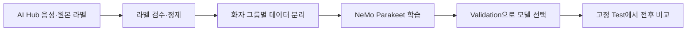

# Child Speech Recognition

[English](README.en.md) · [결과](#results) · [실험 기록](docs/EXPERIMENTS.md) · [공통 디렉터리 기준](../docs/repository_structure.md)

## About

**한국 아동의 영어 음성을 더 정확히 받아쓰도록 Parakeet을 파인튜닝했습니다.**

크레버스에서 수행했던 아동 영어 전사 개선 업무를 바탕으로 한 포트폴리오 재구현입니다.
AI Hub 음성으로 새로 진행한 실험이며, 아래 수치는 당시 회사 시스템의 성능이 아닙니다.
회사 코드·내부 데이터·가중치는 포함하지 않습니다.

## Quick Start

학습 환경을 설치하지 않아도 결과 수치는 볼 수 있습니다. 모노레포 루트에서 실행하세요.

```sh
python3 -m json.tool child_speech_recognition/results/test.json
```

`before.wer`의 0.14448은 14.45%, `after.wer`의 0.08497은 8.50%입니다.
음성 파일과 학습된 모델은 저장소에 없습니다.

## Flow



| 단계 | 구현 |
|---|---|
| 라벨 검수 | 오타와 불명확한 표식을 확인하고, 일부 음성은 로컬 Whisper 전사와 대조 |
| 데이터 준비 | AI Hub 541 자유발화 음성을 화자 그룹별로 나눔 |
| 학습 | Parakeet TDT 0.6B v2, NVIDIA NeMo, PyTorch 학습 루프와 AdamW |
| 모델 선택 | 0.25 epoch마다 Validation WER 측정, 가장 낮은 모델 선택 |
| 성능 측정 | 동일한 Test 음성·정답·텍스트 정규화로 학습 전후 WER·CER 비교 |

### Label Review

전사문이 틀리면 모델은 틀린 문장을 정답으로 배웁니다. 그래서 학습 전에 원본 라벨의
오타와 `NNN` 같은 불명확한 표식을 확인했습니다. 일부 음성은 로컬 Whisper가 받아쓴
문장과도 비교했습니다. 두 문장이 다르다는 이유만으로 라벨을 바꾸지는 않았습니다.
확실하지 않은 문장은 그대로 두고, `NNN`으로 표시된 녹음은 제외했습니다.

이 규칙을 [`asr-review-labels` 명령](src/child_speech/cli/review_labels.py)으로 정리했습니다.
`queue`는 다시 볼 라벨을 모으고, `apply`는 검토자가 승인한 수정만 반영합니다.
원본 ZIP은 그대로 둡니다. 동작 방식은 다음 **가상 예시**로 볼 수 있습니다.

| 원본 라벨 | 처리 |
|---|---|
| `I can spel.` | 오타로 확인되면 `spell`로 수정 |
| `NNN sees a rose.` | 정답을 알 수 없어 제외 |
| `I saw a tree.` | Whisper가 `I see a tree.`라고 써도 원문은 일단 유지 |

명령 사용법과 승인 파일 형식은 [라벨 검수 안내](docs/LABEL_REVIEW.md)에 적었습니다.

### Data & Model

사용 데이터는 [AI Hub 「학습용 아동 영어 음성 데이터」](https://aihub.or.kr/aihubdata/data/view.do?dataSetSn=541)의
**공식 Validation 중 자유발화 음성·라벨**입니다. 아래 Train/Validation/Test는 이 일부를
자체 재분할한 것이며 AI Hub 공식 평가 세트가 아닙니다.

| 데이터 | 음성 수 | 길이 | 용도 |
|---|---:|---:|---|
| Train | 41,183개 | 58.87시간 | 모델 학습 |
| Validation | 5,178개 | 7.16시간 | 학습 중 모델 선택 |
| Test | 4,567개 | 7.41시간 | 선택한 모델의 최종 비교 |

3 epoch 학습 중 **Validation WER가 가장 낮았던 2.75 epoch 모델(10.78%)**을 골랐습니다.
Test는 모델을 고른 뒤 학습 전후를 비교할 때만 썼습니다. Test 점수까지 보고 모델을
골랐다면 최종 성능이 실제보다 좋게 보일 수 있습니다. 목표였던 Validation WER 10%
미만에는 이르지 못했습니다. 자세한 설정은 [실험 기록](docs/EXPERIMENTS.md)에 있습니다.

## Results

**같은 Test 음성 4,567개에서 단어 오류율이 14.45%에서 8.50%로 감소했습니다.**


AI Hub 데이터로 새로 진행한 실험의 수치이며, 포트폴리오에 적힌 과거 회사 시스템의 WER와는
다른 결과입니다. 그림은 공개된 [Test 결과](results/test.json)와 [전사 예시](results/examples.json)만으로 만들었습니다.

| 지표 | 학습 전 | 학습 후 |
|---|---:|---:|
| 단어 오류율 WER ↓ | 14.45% | **8.50%** |
| 문자 오류율 CER ↓ | 8.14% | **4.54%** |

WER는 정답과 비교해 잘못 쓴 단어, 빠뜨린 단어, 추가한 단어의 비율입니다.
이번 결과에서 단어 오류는 상대적으로 **41.2% 감소**했습니다.
[정확한 수치](results/test.json) · [Validation 기록](results/validation.json)

### 실제 전사 예시

| 학습 전 | 학습 후 | 정답 기준 단어 오류 |
|---|---|---:|
| Grandpa's house is in Soul. | Grandpa's house is in Seoul | 1 → 0 |
| And Grandpa read me a book. | And grandpa reads me a book | 0 → 1 |

좋아진 예 하나와 나빠진 예 하나를 골랐습니다. 무작위 표본은 아니므로 전체 성능은
위 Test WER를 기준으로 봐야 합니다. 정답은 데이터셋에 제공된 라벨입니다.
[다른 예시와 선택 기준](results/examples.json)

이 수치는 AI Hub 공식 벤치마크 점수가 아닙니다. 이전 실험에서도 같은 Test 데이터를
본 적이 있어 완전히 새로운 외부 검증 결과도 아닙니다. 화자 구분은 메타데이터를
기준으로 했으며, 실제로 다른 사람인지까지 확인하지는 못했습니다.

## How to Run

### Prerequisites

학습에는 별도 **Linux/CUDA·NeMo 환경**과 접근 권한이 있는 AI Hub 음성이 필요합니다.
공통 Python 환경에는 NeMo를 설치하지 않습니다.
[전용 환경 설치와 고정 데이터 분할 준비](docs/EXPERIMENTS.md#run-the-code)를 먼저 따르세요.

### Data Preparation

1. 위 [AI Hub 데이터셋](https://aihub.or.kr/aihubdata/data/view.do?dataSetSn=541)의 이용 권한을 확보한 뒤,
   이 실험에 사용한 공식 Validation 자유발화 라벨 `VL_eng_free_01.zip`과 음성
   `VS_eng_free_01.zip`을 `.local-data/aihub541/`에 둡니다.
2. [라벨 검수 절차](docs/LABEL_REVIEW.md)로 후보를 확인하고 승인한 수정만 적용합니다.
   결과는 `eligible.jsonl`·`excluded.jsonl`이며, 이 단계에서 Train/Validation/Test는
   아직 만들어지지 않습니다.
3. 학습에는 화자 그룹별로 분리한 `splits/{train,validation,test}.jsonl`이 필요합니다.
   기존 실험은 화자 메타데이터와 음성 해시의 중복을 확인하고 약 80:10:10으로 자체
   분할했습니다. 당시의 승인 파일과 고정 분할 목록은 비공개이며, 공개된 검수 스크립트는
   분할을 생성하지 않습니다. 새 데이터로 분할하면 별도의 실험으로 기록해야 합니다.

### Train & Test

전용 환경과 데이터가 준비된 CUDA 호스트에서 저장소 루트를 기준으로 실행합니다.
`ASR_DATA_DIR`에는 원본 음성 ZIP과 기록된 `splits/{train,validation,test}.jsonl`이 있어야 합니다.
새 실험용 출력 디렉터리를 지정합니다.

```sh
export ASR_DATA_DIR="$PWD/.local-data/aihub541"
export ASR_RUN_DIR="$PWD/.local-data/asr-nemo-reproduction"
.local-data/asr-nemo-venv/bin/python -m child_speech.cli.train
.local-data/asr-nemo-venv/bin/python -m child_speech.cli.evaluate_test
```

두 번째 명령은 Validation으로 모델을 고른 뒤 실행합니다.
데이터·분할 목록·체크포인트가 공개되지 않으므로 저장소만으로 같은 학습 수치를 재현할 수는 없습니다.

<details>
<summary><strong>권한이 있는 음성으로 로컬 청취 예시 만들기</strong></summary>

학습 전후 예측 파일도 준비한 뒤 실행합니다.

```sh
uv pip install --python .venv/bin/python --no-deps -e child_speech_recognition
.venv/bin/python -m child_speech.cli.build_examples \
  --before .local-data/asr-nemo/test-0.jsonl \
  --after .local-data/asr-nemo/test-28314.jsonl \
  --audio-zip .local-data/aihub541/VS_eng_free_01.zip \
  --private-output .local-data/asr-listening \
  --public-output child_speech_recognition/results/examples.json
```

생성된 `.local-data/asr-listening/index.html`을 로컬 브라우저에서 엽니다.
이 HTML에는 원본 음성이 포함되므로 공개하지 않습니다.

</details>

## 코드 둘러보기

Python 코드는 [`src/child_speech`](src/child_speech)에 있습니다.

| 관심 영역 | 시작할 곳 |
|---|---|
| 음성·모델 로딩 | [`common/`](src/child_speech/common) |
| 라벨 후보·승인 처리 | [`data/`](src/child_speech/data) |
| 파인튜닝 | [`training/`](src/child_speech/training) |
| 고정 Test 평가 | [`evaluation/`](src/child_speech/evaluation) |
| 전후 비교·결과 그림·로컬 청취 | [`reporting/`](src/child_speech/reporting) |
| 실행 명령 | [`cli/`](src/child_speech/cli) |

공개 가능한 집계 지표는 [`results/`](results)에, 실험 조건은
[`docs/EXPERIMENTS.md`](docs/EXPERIMENTS.md)에 있습니다.

## 검사

ML 의존성 없이 결과와 전사 예시 처리 코드를 검사합니다. 저장소 루트에서:

```sh
PYTHONPATH=child_speech_recognition/src python3 -m unittest discover -s child_speech_recognition/tests -v
```

결과 그림이 공개 JSON과 일치하는지 확인합니다. `--check`를 빼면 그림을 다시 만듭니다.

```sh
PYTHONPATH=child_speech_recognition/src python3 -m child_speech.reporting.results_overview --check
```

모델 출처: [Parakeet 모델·라이선스](https://huggingface.co/nvidia/parakeet-tdt-0.6b-v2)

[← 모노레포로 돌아가기](../README.md)
