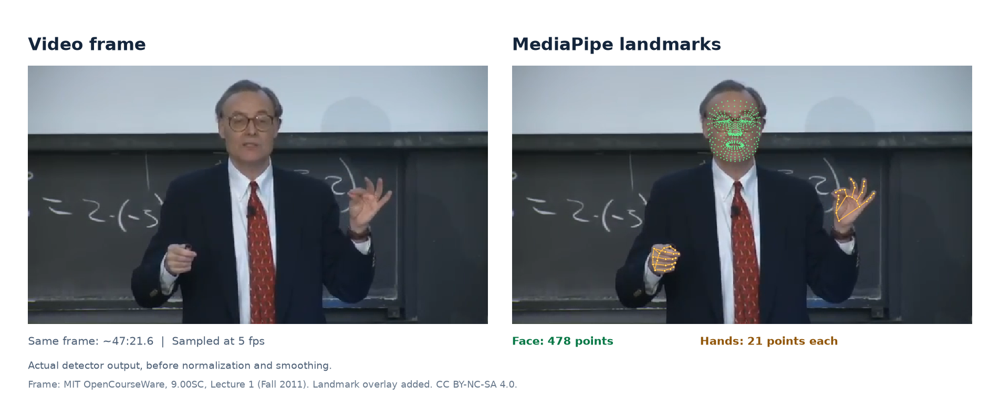
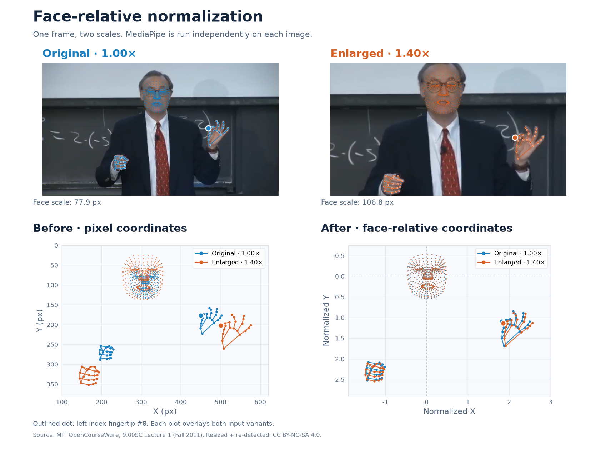
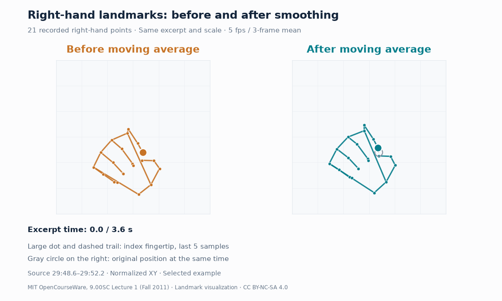

# Presentation Attitude Assessment

[한국어](README.md) · [Quick Start](#quick-start) · [Documentation](docs/README.md) · [Repository layout](../docs/repository_structure.md)

## About

**Assess presentation attitude from an uploaded video, with one decision for the whole video.**

A portfolio reconstruction of work at Creverse, using face and hand movement to
classify presentation attitude as **appropriate / inappropriate**.

Company data, code and weights are not included.

## Flow


| Step | Implementation |
|---|---|
| Read video | FFmpeg → NumPy, sampled at 5 fps |
| Prepare features | MediaPipe landmarks, face-relative XY normalization and moving average |
| Train & evaluate | PyTorch GRU for variable-length videos; F1, ROC-AUC and per-video predictions |
| Serve | FastAPI video uploads and analysis results |

### Feature Extraction (Face · Hand)



<sub>Image source: <a href="https://ocw.mit.edu/courses/9-00sc-introduction-to-psychology-fall-2011/resources/lecture-1-introduction/">MIT OpenCourseWare, 9.00SC Lecture 1 (Fall 2011)</a>.
Adapted with landmark overlays and explanatory labels; this image is distributed under
<a href="https://creativecommons.org/licenses/by-nc-sa/4.0/">CC BY-NC-SA 4.0</a>.</sub>

**Each sampled frame becomes a set of face and hand coordinates.**
Green points mark 478 face landmarks; orange points mark 21 landmarks per hand.
The image shows actual detector output for one frame. The classifier uses each point's X and Y coordinates.

### Pre-process

**1. Normalize to reduce the effect of camera distance**

A person closer to the camera appears larger. Subtracting the face center and dividing
by face size reduces this difference. Both hands use the same reference as the face,
preserving their positions relative to it.

$$
\mathbf{p}' = \frac{\mathbf{p} - \mathbf{c}}{\sqrt{w_f h_f}}
$$

$\mathbf{p}$ is the landmark's pixel coordinate and $\mathbf{c}$ is the face bounding-box center.
$w_f$ and $h_f$ are the width and height of the box enclosing the face landmarks.



The same frame is **enlarged by 1.4×, then MediaPipe is run independently on both images**.
The different positions and sizes align more closely after normalization.
These are the measured coordinates of the **left index fingertip**, highlighted by the larger dot.

| Input image | Before `(X, Y)` · pixels | After `(X, Y)` |
|---|---:|---:|
| Original · 1.00× | (449.8, 177.1) | (1.82, 1.10) |
| Enlarged · 1.40× | (500.8, 202.0) | (1.85, 1.14) |

<sub>The MIT OpenCourseWare frame credited above was enlarged and its landmarks re-extracted for this visualization.
This image is also distributed under <a href="https://creativecommons.org/licenses/by-nc-sa/4.0/">CC BY-NC-SA 4.0</a>.</sub>

**2. Apply a moving average to reduce coordinate jitter**

Detected landmarks can fluctuate between frames. Each normalized X/Y coordinate is
averaged across the **previous, current and next frame**. The complete video is uploaded,
so the next frame is available for this calculation.

$$
\bar{\mathbf{p}}_t = \frac{\mathbf{p}'_{t-1} + \mathbf{p}'_t + \mathbf{p}'_{t+1}}{3}
$$

The average is applied only when all three samples belong to the same valid tracking segment.
At gaps and segment boundaries, available current coordinates are retained; missing coordinates stay missing.



Right-hand coordinates extracted from a real video: before smoothing on the left, after on the right.
The dashed trail follows the index fingertip.
**This approach also helped reduce input coordinate jitter during the original product's development.**

[Coordinate averaging: a numerical example](docs/assets/landmark-smoothing.en.png)

<sub>Landmarks derived from the MIT OpenCourseWare lecture credited above.
This GIF and the numerical example are also distributed under <a href="https://creativecommons.org/licenses/by-nc-sa/4.0/">CC BY-NC-SA 4.0</a>.</sub>

[Preprocessing implementation and rules](docs/guides/preprocessing.md)

### Model Input

**One video becomes a time-ordered coordinate sequence of shape `[T, 1043]`.**
`T` is the number of sampled frames: a one-minute video yields approximately 300 frames at 5 fps.

| Features per frame | Values |
|---|---:|
| Face X/Y | 478 × 2 = 956 |
| Left hand X/Y | 21 × 2 = 42 |
| Right hand X/Y | 21 × 2 = 42 |
| Face / left hand / right hand validity flags | 3 |
| **Total** | **1,043** |

Unavailable coordinates become zeros at the tensor boundary, with their validity flags set to zero.
Videos of different lengths are padded into `[B, T_max, 1043]` batches.
`B` is the number of videos in the batch; `T_max` is its longest sequence length.
The GRU receives each video's actual length and excludes padding.

```text
Coordinate sequence → GRU(hidden=32) → final state → Linear → one decision per video
```

## Quick Start

Install [uv](https://docs.astral.sh/uv/), then run from the **monorepo root**.
This example generates synthetic coordinates and trains a small GRU on CPU for three epochs, without a video.

```sh
uv sync --locked
uv run --locked presentation-training-smoke \
  --output .local-data/presentation-attitude/demo
```

**Input:** 12 generated sequences: eight for training and four for validation.
Each has shape `[8–20 frames, 1043]`. Four separate test sequences are also generated.

**Example output** — verified with the default settings:

```text
epoch 1: train=0.729900 validation=0.554458
epoch 2: train=0.506110 validation=0.388161
epoch 3: train=0.354907 validation=0.280806
Synthetic pipeline check complete: 6 optimizer steps; no attitude performance claim.
```

The model is saved to `demo/training/best.pt`, with training records in `demo/training/summary.json`.
These two classes are synthetic numerical patterns; the results do not establish actual attitude accuracy.
Use a new directory for every `--output` argument.

## How to Run

### Prerequisites

- **All workflows:** [uv](https://docs.astral.sh/uv/) and Python 3.13. Install dependencies with `uv sync --locked`.
- **Video processing:** FFmpeg, with `ffmpeg` and `ffprobe` on `PATH`.
- **Upload UI:** Node.js and npm.

Run the following commands from the monorepo root as well.

### Server

In terminal 1, build the UI and start the upload API:

```sh
npm ci --prefix presentation_attitude_assessment/frontend
npm run build --prefix presentation_attitude_assessment/frontend
uv run --locked presentation-serve
```

In terminal 2, start the video analysis process:

```sh
uv run --locked presentation-worker
```

Upload a video at [localhost:43187/ui/](http://127.0.0.1:43187/ui/).
When analysis finishes, the UI displays face/hand detection and usable-feature ratios.

The default mode extracts features. Appropriate/inappropriate predictions require a model trained
on actual attitude data; the synthetic Quick Start model cannot be used for this mode.
[Serving configuration](docs/guides/serving.md)

### Train

Train on **Mac MPS** using the data generated by Quick Start.
The manifest lists sequence paths, labels and training/validation assignments.

```sh
DEMO_DIR=.local-data/presentation-attitude/demo
uv run --locked presentation-train \
  --manifest "$DEMO_DIR/data/manifest.json" \
  --output "$DEMO_DIR/training-mps" \
  --epochs 3 --batch-size 4 --device mps
```

Use `--device cpu` when MPS is unavailable. For real video training, prepare a manifest
from extracted sequences and reviewed attitude labels.
[Training data format and settings](docs/guides/gru_training.md)

### Test

Evaluate the model saved by Train on the **four test sequences excluded from training**.
`--device auto` uses MPS when available, otherwise CPU.

```sh
DEMO_DIR=.local-data/presentation-attitude/demo
uv run --locked presentation-evaluate \
  --checkpoint "$DEMO_DIR/training-mps/best.pt" \
  --manifest "$DEMO_DIR/test-data/manifest.json" \
  --training-manifest "$DEMO_DIR/data/manifest.json" \
  --output "$DEMO_DIR/evaluation" \
  --device auto
```

| File in `demo/evaluation/` | Contents |
|---|---|
| `summary.json` | Accuracy, precision, recall, F1, ROC-AUC and confusion matrix |
| `predictions.jsonl` | Labels, predictions and probabilities per sequence |
| `misclassifications.jsonl` | Misclassified sequences |

These example metrics concern synthetic data. Actual performance requires an independent, attitude-labeled test set.
[Evaluation and interpreting results](docs/guides/evaluation.md)

<details>
<summary><strong>Extract features from your own video via CLI</strong></summary>

Replace the input path with your own video:

```sh
uv run --locked presentation-process /path/to/video.mp4 \
  --output .local-data/presentation-attitude/my-video \
  --fps 5 --window 3
```

The first run downloads and verifies MediaPipe models.
`sequence.jsonl` stores per-frame coordinates; `summary.json` stores the processing summary.
[Output format](docs/guides/whole_video_pipeline.md)

</details>

## Explore the Code

Python code lives in [`src/presentation_attitude`](src/presentation_attitude).

| Area | Start here |
|---|---|
| Model and inference | [`models/`](src/presentation_attitude/models) |
| Data and preprocessing | [`data/`](src/presentation_attitude/data) |
| End-to-end workflows | [`pipelines/`](src/presentation_attitude/pipelines) |
| Video input and tracking | [`vision/`](src/presentation_attitude/vision) |
| API and worker | [`serving/`](src/presentation_attitude/serving) |

[Architecture and public interfaces](docs/guides/python_structure.md) ·
[Annotation criteria](docs/guides/presentation_attitude.md) ·
[Data availability](docs/data/data_access_review.md)

Detailed guides are currently in Korean.

## Checks

```sh
uv run --locked python -m unittest discover -s presentation_attitude_assessment/tests -v
```

**75 tests passed** on 2026-09-26, covering video input, preprocessing, training, evaluation and job processing.
[Verification details and lint commands](docs/guides/python_structure.md#검사-명령)

[← Back to the monorepo](../README.en.md)
