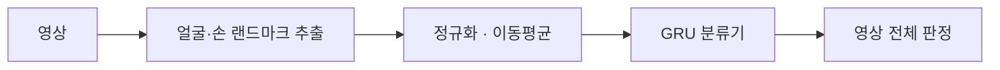
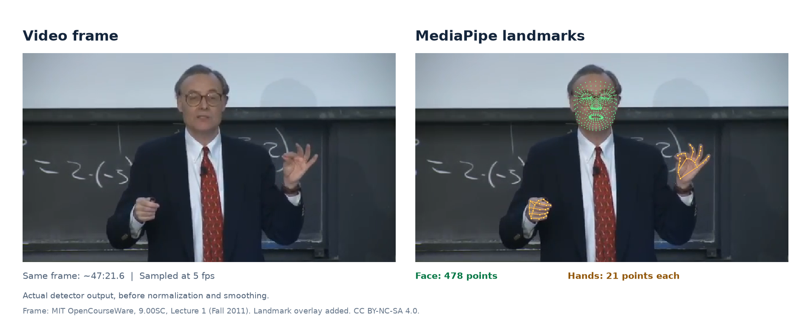
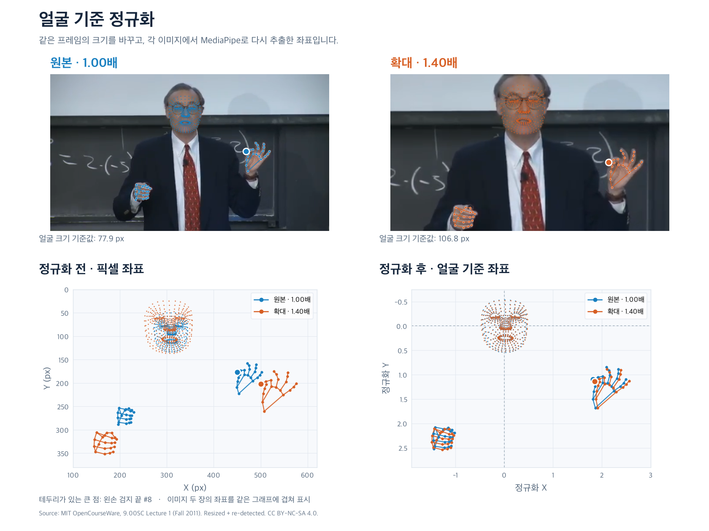
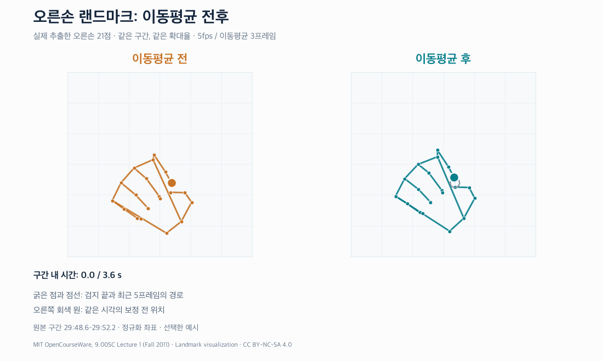

# Presentation Attitude Assessment

[English](README.en.md) · [Quick Start](#quick-start) · [문서](docs/README.md) · [공통 디렉터리 기준](../docs/repository_structure.md)

## About

**발표 영상을 입력받아, 영상 전체의 발표 태도를 평가합니다.**

크레버스에서 수행했던 업무를 바탕으로 만든 포트폴리오 재구현입니다.
얼굴과 손의 움직임을 이용해 발표 태도를 **적절 / 부적절**로 분류하는 구조입니다.

회사 내부 데이터·코드·가중치는 포함하지 않습니다.

## Flow



| 단계 | 구현 |
|---|---|
| 영상 읽기 | FFmpeg → NumPy, 5fps 샘플링 |
| 특징 준비 | MediaPipe 랜드마크, 얼굴 기준 XY 정규화와 이동평균 |
| 학습·평가 | 가변 길이 영상을 처리하는 PyTorch GRU, F1·ROC-AUC·영상별 예측 |
| 서빙 | FastAPI 영상 업로드·분석 결과 조회 |

### Feature Extraction (Face · Hand)



<sub>이미지 출처: <a href="https://ocw.mit.edu/courses/9-00sc-introduction-to-psychology-fall-2011/resources/lecture-1-introduction/">MIT OpenCourseWare, 9.00SC Lecture 1 (Fall 2011)</a>.
강의 프레임에 랜드마크와 설명을 추가한 이미지이며, <a href="https://creativecommons.org/licenses/by-nc-sa/4.0/">CC BY-NC-SA 4.0</a>으로 제공합니다.</sub>

**영상의 각 프레임을 얼굴·손의 좌표로 바꿉니다.**
초록색 점은 얼굴 478개, 주황색 점은 손마다 21개의 랜드마크입니다.
위 그림은 실제 추출 결과 중 한 프레임이며, 분류기에는 각 점의 X·Y 좌표를 사용합니다.

### Pre-process

**1. 촬영 거리의 영향을 줄이는 정규화**

카메라에 가까이 있으면 얼굴과 손이 크게, 멀리 있으면 작게 찍힙니다.
이 차이를 줄이기 위해 얼굴 중심을 빼고 얼굴 크기로 나눕니다.
얼굴과 양손에 같은 기준을 적용해, 얼굴을 기준으로 한 손의 상대 위치를 유지합니다.

$$
\mathbf{p}' = \frac{\mathbf{p} - \mathbf{c}}{\sqrt{w_f h_f}}
$$

$\mathbf{p}$는 랜드마크의 픽셀 좌표, $\mathbf{c}$는 얼굴 영역의 중심입니다.
$w_f$, $h_f$는 얼굴 랜드마크를 둘러싼 영역의 너비와 높이입니다.



같은 프레임을 **1.4배 확대한 뒤, 두 이미지에서 MediaPipe를 각각 다시 실행**했습니다.
정규화 전에는 크기와 위치가 달랐던 좌표가, 정규화 후에는 비슷하게 겹칩니다.
그림에서 큰 점으로 표시한 **왼손 검지 끝**의 실제 좌표입니다.

| 입력 이미지 | 정규화 전 `(X, Y)` · 픽셀 | 정규화 후 `(X, Y)` |
|---|---:|---:|
| 원본 · 1.00배 | (449.8, 177.1) | (1.82, 1.10) |
| 확대 · 1.40배 | (500.8, 202.0) | (1.85, 1.14) |

<sub>위 MIT OpenCourseWare 강의 프레임을 확대하고, 재추출한 좌표를 시각화했습니다.
이 이미지도 <a href="https://creativecommons.org/licenses/by-nc-sa/4.0/">CC BY-NC-SA 4.0</a>으로 제공합니다.</sub>

**2. 검출 좌표의 잔떨림을 줄이는 이동평균**

랜드마크는 같은 부위를 추적해도 프레임마다 조금씩 튈 수 있습니다.
각 점의 정규화된 X·Y 좌표에 **이전·현재·다음 3프레임의 평균**을 적용합니다.
영상 전체를 업로드받는 방식이므로 다음 프레임도 참고할 수 있습니다.

$$
\bar{\mathbf{p}}_t = \frac{\mathbf{p}'_{t-1} + \mathbf{p}'_t + \mathbf{p}'_{t+1}}{3}
$$

연속된 유효 좌표 3개가 있을 때만 평균을 냅니다.
검출 누락이나 추적 구간의 경계에서는 현재 좌표를 유지하고, 누락된 좌표를 임의로 채우지 않습니다.



실제 영상에서 추출한 오른손 좌표입니다. 왼쪽은 적용 전, 오른쪽은 이동평균 후이며 점선은 검지 끝의 이동 경로입니다.
**실제 제품 개발에서도 입력 좌표의 잔떨림을 줄이는 데 도움이 되었습니다.**

[좌표값을 평균하는 계산 예시](docs/assets/landmark-smoothing.png)

<sub>위 MIT OpenCourseWare 강의의 추출 좌표를 시각화했습니다.
이 GIF와 계산 예시도 <a href="https://creativecommons.org/licenses/by-nc-sa/4.0/">CC BY-NC-SA 4.0</a>으로 제공합니다.</sub>

[전처리 구현과 세부 규칙](docs/guides/preprocessing.md)

### Model Input

**영상 하나를 시간순 좌표 시퀀스 `[T, 1043]`으로 만듭니다.**
`T`는 샘플링한 프레임 수입니다. 예를 들어 1분 영상은 5fps에서 약 300프레임입니다.

| 한 프레임의 구성 | 값의 개수 |
|---|---:|
| 얼굴 X·Y | 478 × 2 = 956 |
| 왼손 X·Y | 21 × 2 = 42 |
| 오른손 X·Y | 21 × 2 = 42 |
| 얼굴·왼손·오른손 특징의 사용 가능 여부 | 3 |
| **합계** | **1,043** |

사용할 수 없는 부위는 모델 입력에서 좌표를 0으로 채우고, 사용 가능 여부도 0으로 표시합니다.
길이가 다른 영상들을 함께 학습할 때는 뒤에 패딩을 붙여 `[B, T_max, 1043]`으로 묶습니다.
`B`는 한 번에 처리하는 영상 수, `T_max`는 그중 가장 긴 시퀀스의 길이입니다.
각 영상의 실제 길이도 전달하므로 GRU는 패딩을 제외하고 처리합니다.

```text
좌표 시퀀스 → GRU(hidden=32) → 마지막 상태 → Linear → 영상당 판정 1개
```

## Quick Start

[uv](https://docs.astral.sh/uv/)를 설치한 뒤 **모노레포 루트**에서 실행합니다.
영상 없이 합성 좌표를 만들고, 작은 GRU를 CPU에서 3 epoch 학습하는 예제입니다.

```sh
uv sync --locked
uv run --locked presentation-training-smoke \
  --output .local-data/presentation-attitude/demo
```

**입력:** 명령이 직접 생성하는 합성 시퀀스 12개(학습 8개·검증 4개).
각 시퀀스는 `[8~20프레임, 1043]` 형태이며, 별도 테스트 시퀀스 4개도 생성합니다.

**실행 결과 예시** — 기본 설정으로 확인한 출력입니다.

```text
epoch 1: train=0.729900 validation=0.554458
epoch 2: train=0.506110 validation=0.388161
epoch 3: train=0.354907 validation=0.280806
Synthetic pipeline check complete: 6 optimizer steps; no attitude performance claim.
```

`demo/training/best.pt`에 모델, `demo/training/summary.json`에 학습 기록이 저장됩니다.
여기서 구분하는 두 클래스는 합성 숫자 패턴이며, 이 결과로 실제 발표 태도 성능을 판단할 수 없습니다.
모든 실행 명령의 `--output`에는 새 폴더를 지정하세요.

## How to Run

### Prerequisites

- **공통:** [uv](https://docs.astral.sh/uv/)와 Python 3.13. `uv sync --locked`로 의존성을 설치합니다.
- **영상 처리:** FFmpeg. `ffmpeg`, `ffprobe`가 `PATH`에 등록되어 있어야 합니다.
- **업로드 UI:** Node.js·npm.

이하 명령도 모노레포 루트에서 실행합니다.

### Server

터미널 1에서 UI를 빌드하고 업로드 API를 시작합니다.

```sh
npm ci --prefix presentation_attitude_assessment/frontend
npm run build --prefix presentation_attitude_assessment/frontend
uv run --locked presentation-serve
```

터미널 2에서 영상 분석 프로그램을 시작합니다.

```sh
uv run --locked presentation-worker
```

[localhost:43187/ui/](http://127.0.0.1:43187/ui/)에서 영상을 업로드합니다.
분석이 끝나면 화면에 얼굴·손 검출률과 사용 가능한 특징 비율이 표시됩니다.

기본 실행은 특징 추출 모드입니다. 적절·부적절 판정에는 실제 태도 데이터로 학습한
체크포인트가 필요하며, Quick Start의 합성 학습 모델은 사용할 수 없습니다.
[서빙 설정](docs/guides/serving.md)

### Train

Quick Start에서 만든 데이터로 **Mac의 MPS에서 학습**하는 예제입니다.
`manifest.json`은 시퀀스 경로·라벨·학습/검증 구분을 담은 데이터 목록입니다.

```sh
DEMO_DIR=.local-data/presentation-attitude/demo
uv run --locked presentation-train \
  --manifest "$DEMO_DIR/data/manifest.json" \
  --output "$DEMO_DIR/training-mps" \
  --epochs 3 --batch-size 4 --device mps
```

MPS를 사용하지 않는 환경에서는 `--device cpu`로 바꿉니다.
실제 영상으로 학습할 때는 특징 추출 결과와 검수한 태도 라벨로 데이터 목록을 준비합니다.
[학습 데이터 형식과 설정](docs/guides/gru_training.md)

### Test

위 Train 단계에서 저장한 모델을 **학습에 사용하지 않은 테스트 시퀀스 4개**로 평가합니다.
`--device auto`는 MPS가 가능하면 MPS, 아니면 CPU를 선택합니다.

```sh
DEMO_DIR=.local-data/presentation-attitude/demo
uv run --locked presentation-evaluate \
  --checkpoint "$DEMO_DIR/training-mps/best.pt" \
  --manifest "$DEMO_DIR/test-data/manifest.json" \
  --training-manifest "$DEMO_DIR/data/manifest.json" \
  --output "$DEMO_DIR/evaluation" \
  --device auto
```

| 결과 파일 (`demo/evaluation/`) | 내용 |
|---|---|
| `summary.json` | Accuracy, Precision, Recall, F1, ROC-AUC, 혼동행렬 |
| `predictions.jsonl` | 시퀀스별 정답·예측·확률 |
| `misclassifications.jsonl` | 오분류된 시퀀스 |

이 예제의 지표는 합성 데이터 기준입니다. 실제 성능 평가는 독립된 태도 라벨 데이터로 수행해야 합니다.
[성능 평가와 결과 읽기](docs/guides/evaluation.md)

<details>
<summary><strong>CLI로 내 영상의 특징만 추출하기</strong></summary>

입력 경로를 본인 영상으로 바꿔 실행합니다.

```sh
uv run --locked presentation-process /path/to/video.mp4 \
  --output .local-data/presentation-attitude/my-video \
  --fps 5 --window 3
```

처음 실행하면 MediaPipe 모델을 내려받아 검증합니다.
`sequence.jsonl`에는 프레임별 좌표가, `summary.json`에는 처리 요약이 저장됩니다.
[출력 형식](docs/guides/whole_video_pipeline.md)

</details>

## 코드 둘러보기

Python 코드는 [`src/presentation_attitude`](src/presentation_attitude)에 있습니다.

| 관심 영역 | 시작할 곳 |
|---|---|
| 모델·추론 | [`models/`](src/presentation_attitude/models) |
| 데이터·전처리 | [`data/`](src/presentation_attitude/data) |
| 전체 실행 흐름 | [`pipelines/`](src/presentation_attitude/pipelines) |
| 영상 입력·추적 | [`vision/`](src/presentation_attitude/vision) |
| API·워커 | [`serving/`](src/presentation_attitude/serving) |

[구조와 공개 인터페이스](docs/guides/python_structure.md) ·
[라벨링 기준](docs/guides/presentation_attitude.md) ·
[데이터 확보 현황](docs/data/data_access_review.md)

상세 가이드는 현재 한국어로 작성돼 있습니다.

## 검사

```sh
uv run --locked python -m unittest discover -s presentation_attitude_assessment/tests -v
```

2026-09-26 검증에서 **테스트 75개가 통과**했습니다.
영상 입력·전처리·학습·평가·작업 처리를 검사합니다.
[검증 상세와 lint 명령](docs/guides/python_structure.md#검사-명령)

[← 모노레포로 돌아가기](../README.md)
