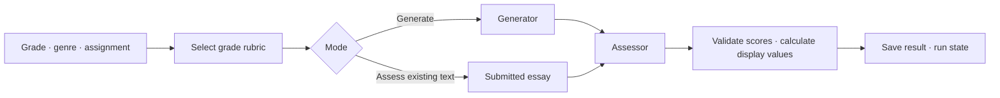

# Writing Data Synthesis

[한국어](README.md) · [Quick Start](#quick-start) · [Grade rubrics](criteria/README.en.md) · [Repository layout](../docs/repository_structure.md)

## About

**Generate English writing for a requested grade and genre, then assess it against a selected rubric.**

This portfolio project reconstructs writing data generation work at Creverse.
Its generation, assessment and storage flow can be run with fixed Mock responses.
Company code and private student data are not included.

## Quick Start

Install [uv](https://docs.astral.sh/uv/) and run from the **monorepo root**.
Without a model server, this checks one grade-6 argumentative request through generation,
assessment, result retrieval and reopening SQLite.

```sh
uv sync --locked
uv run --locked writing-mock-smoke \
  --data-dir .local-data/writing-data-synthesis/readme-demo
```

**Input:** a fictional school-garden assignment and passage, with a grade-6 argumentative rubric.
**Output:** `execution_mode: mock`, a run ID, a result JSON path and a SQLite path.
The command verifies `POST /run → Mock generation → Mock assessment → SQLite → GET /runs/{id}`.
Mock writing and ratings do not establish educational quality or suitability as a real dataset.

## Flow



| Step | Implementation |
|---|---|
| Select criteria | Choose the requested genre from one of 13 grade-specific files, kindergarten through grade 12 |
| Generate and assess | OpenAI-compatible SDK adapter or a network-free Mock |
| Process results | Validate responses with Pydantic and calculate display values in code |
| Record a run | FastAPI requests and stage snapshots in SQLite, with a local Next.js UI |

### Grade rubrics

**Thirteen grade files contain 39 grade-and-genre selections.**
For example, a grade-6 argumentative request loads the argumentative criteria from the grade-6 file.
K–5 support opinion, informative and narrative writing; grades 6–12 support argumentative,
informative and narrative writing.
[Browse grade rubrics](criteria/README.en.md) · [Sources and reconstruction](docs/rubric-evidence/README.en.md)

Content, organization, expression and conventions receive separate **1–4 ratings**.
Source use is rated only when the assignment requires it.
Code maps each rating to a 0–100 display value. These values are not a total score
or a measure for comparing ability across grades.

### Generator and assessor inputs

| Role | Receives | Does not receive |
|---|---|---|
| Generator | Assignment, selected grade/genre criteria, target level and required passages | An existing essay |
| Assessor | Same assignment and criteria, completed essay and required passages | The generator's target level |

Assessment-only requests skip generation and assess the submitted essay.
The application validates the returned scores and status, then saves a snapshot of each run stage.

## How to Run

### Prerequisites

- **Shared runtime:** Python 3.13 and [uv](https://docs.astral.sh/uv/). Run `uv sync --locked` from the root.
- **Local UI:** Node.js and npm.
- **Live model connection:** an OpenAI-compatible Chat Completions server and an available model.

### Server

From the monorepo root, install UI dependencies and start the Mock API and UI together:

```sh
npm ci --prefix writing_data_synthesis/frontend
uv run --locked writing-ui
```

Open [localhost:18742](http://127.0.0.1:18742) and fill the fictional example.
The API runs on port 18741; Ctrl+C stops both processes.
Use `--api-port` and `--ui-port` if those ports are occupied.
This launcher runs in Mock mode.

### API

| Endpoint | Result |
|---|---|
| `POST /run` | Generate and assess, or assess a supplied essay |
| `GET /runs/{run_id}` | Retrieve saved writing, assessment and run state |
| `GET /criteria?family=project` | List the 39 grade/genre selections |
| `GET /runtime` | Identify Mock or live model mode |

The primary demo specifies `rubric_id: "project-writing-v1"`, a grade such as `us_6`,
a supported `genre`, and an assignment in `user_prompt`.
Generation also uses `level`; assessment-only requests provide `essay`.
Argumentative tasks require `source_passages`.

<details>
<summary><strong>Live model configuration</strong></summary>

To run the API directly, set `WDS_LLM_MODE=openai` and the server's
`WDS_LLM_BASE_URL`, `WDS_LLM_MODEL` and `WDS_LLM_API_KEY`.
The default base URL is `http://localhost:11434/v1`.
The adapter uses the OpenAI SDK's text Chat Completions format; ambient
`OPENAI_API_KEY` and `OPENAI_BASE_URL` are ignored.
The `writing-ui` launcher selects Mock instead of live model settings.

Writing quality and assessment reliability for a live model have not been verified here.
SQLite retains interrupted runs, but does not resume them automatically.

</details>

## Explore the Code

Python code lives in [`src/writing_synthesis`](src/writing_synthesis).

| Area | Start here |
|---|---|
| Run flow | [`workflows/`](src/writing_synthesis/workflows) |
| Writing and assessment | [`agents/`](src/writing_synthesis/agents) |
| Grade routing | [`criteria/`](src/writing_synthesis/criteria) |
| Model adapter and Mock | [`llm/`](src/writing_synthesis/llm) |
| API and persistence | [`api/`](src/writing_synthesis/api) · [`storage/`](src/writing_synthesis/storage) |
| Request and assessment schemas | [`schemas/`](src/writing_synthesis/schemas) |

Executable rubrics are in [`criteria/grades/`](criteria/grades);
readable rubrics and evidence start at the [rubric guide](criteria/README.en.md).

## Checks

From the monorepo root:

```sh
uv run --locked python -m unittest discover -s writing_data_synthesis/tests -t writing_data_synthesis -q
uv run --locked writing-materialize-rubrics --check
```

Checks cover grade/genre routing, score contracts, separated model inputs,
failure records and retrieval after persistence.
The current workflow runs one generation-and-assessment cycle or assesses supplied writing.
Acceptance, regeneration and batch dataset export are not implemented.

[← Back to the monorepo](../README.en.md)
