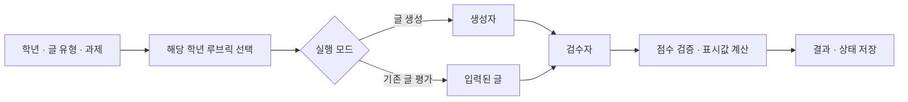

# Writing Data Synthesis

[English](README.en.md) · [Quick Start](#quick-start) · [학년별 루브릭](criteria/README.md) · [공통 디렉터리 기준](../docs/repository_structure.md)

## About

**요청한 학년과 글 유형에 맞는 영어 글을 만들고, 정해진 루브릭으로 검수합니다.**

크레버스에서 수행했던 글쓰기 데이터 생성 업무를 바탕으로 만든 포트폴리오 재구현입니다.
생성·검수·저장 흐름은 고정 Mock 응답으로 실행해 볼 수 있습니다.
회사 코드와 비공개 학생 데이터는 포함하지 않습니다.

## Quick Start

[uv](https://docs.astral.sh/uv/)를 설치한 뒤 **모노레포 루트**에서 실행합니다.
모델 서버 없이 6학년 논증문 한 편의 생성·검수·결과 조회·SQLite 재열기를 확인합니다.

```sh
uv sync --locked
uv run --locked writing-mock-smoke \
  --data-dir .local-data/writing-data-synthesis/readme-demo
```

**입력:** 학교 정원에 관한 가상 과제와 지문, 6학년 논증문 루브릭.
**출력:** `execution_mode: mock`, 실행 ID, 결과 JSON 경로와 SQLite 경로.
실제 실행에서는 `POST /run → Mock 생성 → Mock 검수 → SQLite → GET /runs/{id}`까지 검증합니다.
Mock 글과 점수는 교육적 품질이나 실제 데이터셋으로서의 적합성을 보여주지 않습니다.

## Flow



| 단계 | 구현 |
|---|---|
| 기준 선택 | 유치원부터 12학년까지 13개 파일에서 요청한 글 유형의 기준을 선택 |
| 생성·검수 | OpenAI 호환 SDK 어댑터 또는 네트워크가 필요 없는 Mock |
| 결과 처리 | Pydantic으로 응답을 검증하고 코드가 표시값을 계산 |
| 실행 기록 | FastAPI 요청과 단계별 상태를 SQLite에 저장, Next.js 로컬 UI 제공 |

### 학년별 루브릭

**13개 학년 파일에 총 39개 학년·글 유형 조합**이 들어 있습니다.
예를 들어 6학년 논증문 요청은 6학년 파일에서 논증문 기준을 고릅니다.
K–5는 의견문·정보문·서사문, 6–12학년은 논증문·정보문·서사문을 지원합니다.
[학년별 평가표](criteria/README.md) · [출처와 재구성 근거](docs/rubric-evidence/README.md)

내용·구성·표현·문법을 각각 **1–4점**으로 평가합니다.
출처 사용은 해당 과제에서만 평가하며, 코드가 각 항목을 0–100 표시값으로 바꿉니다.
이 값은 총점이나 학년 간 실력 비교 점수가 아닙니다.

### 생성자와 검수자의 입력

| 역할 | 받는 정보 | 받지 않는 정보 |
|---|---|---|
| 생성자 | 과제, 선택한 학년·글 유형 기준, 목표 수준, 필요한 지문 | 이미 작성된 글 |
| 검수자 | 같은 과제와 기준, 작성된 글, 필요한 지문 | 생성자에게 준 목표 수준 |

평가 전용 요청에서는 생성자를 건너뛰고 입력된 글을 검수합니다.
반환된 점수와 상태를 검사한 뒤 실행 단계별 스냅샷을 저장합니다.

## How to Run

### Prerequisites

- **공통:** Python 3.13과 [uv](https://docs.astral.sh/uv/). 루트에서 `uv sync --locked`를 실행합니다.
- **로컬 UI:** Node.js·npm.
- **실제 모델 연결:** OpenAI 호환 Chat Completions 서버와 해당 모델.

### Server

모노레포 루트에서 UI 의존성을 설치한 뒤 Mock API와 UI를 함께 시작합니다.

```sh
npm ci --prefix writing_data_synthesis/frontend
uv run --locked writing-ui
```

[localhost:18742](http://127.0.0.1:18742)에서 가상 예시를 채워 실행할 수 있습니다.
API는 18741 포트에서 실행하며, Ctrl+C로 둘 다 종료합니다.
포트가 사용 중이면 `--api-port`, `--ui-port`로 직접 변경합니다.
이 실행 명령은 Mock 모드를 사용합니다.

### API

| 경로 | 결과 |
|---|---|
| `POST /run` | 글 생성·평가 또는 입력 글 평가 |
| `GET /runs/{run_id}` | 저장된 글·평가·실행 상태 조회 |
| `GET /criteria?family=project` | 39개 학년·글 유형 조합 조회 |
| `GET /runtime` | Mock 또는 실제 모델 연결 모드 확인 |

주요 데모는 `rubric_id: "project-writing-v1"`, `us_6` 같은 학년,
지원하는 `genre`, 과제 설명 `user_prompt`를 사용합니다.
생성 모드에는 `level`, 평가 전용 모드에는 `essay`를 추가합니다.
논증문에는 `source_passages`가 필요합니다.

<details>
<summary><strong>실제 모델 연결 설정</strong></summary>

API를 직접 실행할 때 `WDS_LLM_MODE=openai`와 사용할 서버의
`WDS_LLM_BASE_URL`, `WDS_LLM_MODEL`, `WDS_LLM_API_KEY`를 설정합니다.
기본 주소는 `http://localhost:11434/v1`입니다.
OpenAI SDK의 텍스트 Chat Completions 형식을 사용하며,
일반 `OPENAI_API_KEY`와 `OPENAI_BASE_URL` 환경변수는 읽지 않습니다.
UI 실행 명령 `writing-ui`는 실제 모델 설정 대신 Mock을 선택합니다.

실제 모델 출력의 글 품질과 평가 신뢰도는 이 저장소에서 검증하지 않았습니다.
실행 상태는 SQLite에 보존되지만 중단된 실행은 자동 재개하지 않습니다.

</details>

## 코드 둘러보기

Python 코드는 [`src/writing_synthesis`](src/writing_synthesis)에 있습니다.

| 관심 영역 | 시작할 곳 |
|---|---|
| 실행 흐름 | [`workflows/`](src/writing_synthesis/workflows) |
| 글 생성·검수 | [`agents/`](src/writing_synthesis/agents) |
| 학년별 기준 선택 | [`criteria/`](src/writing_synthesis/criteria) |
| 모델 연결·Mock | [`llm/`](src/writing_synthesis/llm) |
| API·상태 저장 | [`api/`](src/writing_synthesis/api) · [`storage/`](src/writing_synthesis/storage) |
| 요청·평가 스키마 | [`schemas/`](src/writing_synthesis/schemas) |

실행용 루브릭은 [`criteria/grades/`](criteria/grades)에,
읽기용 평가표와 근거는 [루브릭 안내](criteria/README.md)에 있습니다.

## 검사

모노레포 루트에서:

```sh
uv run --locked python -m unittest discover -s writing_data_synthesis/tests -t writing_data_synthesis -q
uv run --locked writing-materialize-rubrics --check
```

학년·글 유형 선택, 점수 계약, 모델 입력 분리, 실패 기록과 저장 후 조회를 검사합니다.
현재 구현은 한 번의 생성·평가 또는 입력 글 평가까지입니다.
결과 채택·재생성 규칙과 데이터셋 일괄 내보내기는 아직 구현하지 않았습니다.

[← 모노레포로 돌아가기](../README.md)
